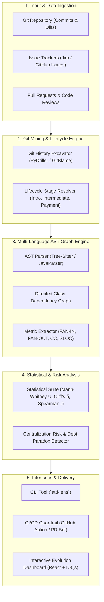
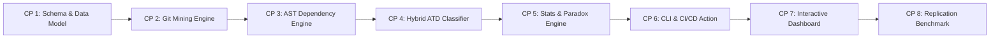

# ArchDebt-Lens: Automated Architectural Technical Debt (ATD) Lifecycle & Dependency Evolution Platform

> **Technical Blueprint & Phased Checkpoint Specification**  
> *Based on the empirical findings of: "Tracing the Lifecycle of Architecture Technical Debt in Software Systems: A Dependency Approach" (Sutoyo, Avgeriou, Capiluppi, 2025)*  
> **Project by:** Dev Pandya (M26CSE003) & Ayush Pundir (M26CSE001)

---

## 1. Executive Summary & Problem Context

### 1.1 Context from the Research Paper
Architectural Technical Debt (ATD) represents structural compromises—such as modularity violations, architectural bypasses, and circular couplings—that accelerate initial velocity but impose compounding long-term maintenance costs.

In their 2025 empirical study (*arXiv:2501.15387v2*), Sutoyo, Avgeriou, and Capiluppi uncovered three fundamental challenges in how software engineering manages ATD:

1. **The ATD Repayment Paradox (Centralization Risk):**
   When developers repay ATD (e.g., refactoring modularity violations), class connectivity does **not** decrease; rather, incoming dependencies (**FAN-IN**) increase by an average of **+57.5%** and outgoing dependencies (**FAN-OUT**) by **+26.7%**. Repayment frequently condenses responsibilities into fewer, central classes, unintentionally creating new architectural bottlenecks and single points of failure.
2. **The "Code Avoidance" Phenonemon in ATD Files:**
   Files associated with ATD undergo significantly fewer modifications (**6.98 avg changes** vs. **16.12 avg changes** for Non-ATD files). Furthermore, cyclomatic complexity is **negatively correlated** with modification frequency in ATD files ($r = -0.089, p < 0.001$), proving that engineers actively avoid touching high-debt, complex modules due to fear of cascading breakage.
3. **Detection Inadequacy of Existing Tools:**
   Standard Natural Language Processing (NLP) models trained on Self-Admitted Technical Debt (SATD) suffer from severe false-positive rates when identifying ATD (over 50% false positives, with ATD accounting for only 0.13% of all debt). Furthermore, commercial static analysis tools (e.g., SciTools Understand) lack automated Git-lifecycle tracing from debt introduction to repayment.

### 1.2 Proposed Software Solution: `ArchDebt-Lens`
`ArchDebt-Lens` is an open-source, automated software intelligence platform and CI/CD guardrail designed to:
- **Trace the full Git lifecycle** of ATD instances from **Introduction** $\rightarrow$ **Evolution** $\rightarrow$ **Repayment**.
- **Replace commercial static analyzers** with a modular, AST-based dependency graph engine (Java, Python, C++, TypeScript).
- **Quantify structural coupling** using FAN-IN, FAN-OUT, SLOC normalization, and cyclomatic complexity.
- **Detect the "Repayment Paradox" in CI/CD**, warning developers when a refactoring PR creates dangerous dependency centralization.
- **Automate rigorous statistical evaluation** (Mann-Whitney U, Cliff's Delta, Partial Spearman Correlation controlling for SLOC).

---

## 2. System Architecture & High-Level Design

### Core System Components:
1. **`atd-miner` (Git History & Lifecycle Mining Engine):** Mines commit histories, issue trackers, and pull requests to isolate commits corresponding to ATD introduction and repayment moments.
2. **`atd-graph` (Static Dependency & Coupling Engine):** AST-driven multi-language dependency analyzer that builds directed dependency graphs and computes class-level FAN-IN, FAN-OUT, SLOC, and cyclomatic complexity across historical commits.
3. **`atd-classifier` (Hybrid ATD Detection Model):** Combines LLM/NLP analysis of issue/PR text with structural AST graph diffs to detect Violation of Modularity (VioMod) with high precision.
4. **`atd-stats` (Statistical & Paradox Risk Evaluator):** Calculates distribution shifts, effect sizes, partial Spearman correlations, and flags excessive architectural centralization during repayments.
5. **`atd-guardrail` & `atd-ui` (CI/CD Action & Visual Dashboard):** Blocks PRs that introduce unmitigated architectural coupling bottlenecks and visualizes code evolution over time.

---

## 3. Mathematical & Algorithmic Formulations

### 3.1 Class Dependency Metrics
For a directed software dependency graph $G = (V, E)$, where $V$ represents the set of classes/source files and $E \subseteq V \times V$ represents directed dependency relationships (import, instantiation, method invocation, inheritance):

- **FAN-IN (Incoming Connectivity / Centrality):**
  $$\text{FAN-IN}(v) = |\{ u \in V \setminus \{v\} : (u, v) \in E \}|$$
  *Significance:* Indicates the degree to which other modules depend on class $v$. High FAN-IN indicates core components whose modification risks cascading breakages.

- **FAN-OUT (Outgoing Connectivity / Coupling):**
  $$\text{FAN-OUT}(v) = |\{ w \in V \setminus \{v\} : (v, w) \in E \}|$$
  *Significance:* Indicates the external dependencies required by class $v$. High FAN-OUT signifies high coupling and difficulty in isolation/testing.

- **Normalized Connectivity Metrics (Controlling for File Size):**
  $$\text{FAN-IN}_{\text{norm}}(v) = \frac{\text{FAN-IN}(v)}{\text{SLOC}(v)}, \quad \text{FAN-OUT}_{\text{norm}}(v) = \frac{\text{FAN-OUT}(v)}{\text{SLOC}(v)}$$

### 3.2 Statistical Evaluation Formulations
- **Mann-Whitney U Test (Non-Parametric Group Comparison):**
  Evaluates whether the distribution of dependency metrics in the payment phase stochastically dominates the introduction phase:
  $$U_1 = R_1 - \frac{n_1(n_1 + 1)}{2}, \quad U_2 = R_2 - \frac{n_2(n_2 + 1)}{2}$$
  Where $n_1, n_2$ are sample sizes at introduction and payment, and $R_1, R_2$ are sum of ranks.

- **Cliff's Delta ($\delta$) Effect Size:**
  Quantifies the magnitude of difference between introduction ($X$) and repayment ($Y$) distributions:
  $$\delta = \frac{\sum_{i=1}^{n_1} \sum_{j=1}^{n_2} \text{sign}(x_i - y_j)}{n_1 n_2}$$
  Interpretation thresholds:
  - $|\delta| < 0.147$: Negligible
  - $0.147 \le |\delta| < 0.330$: Small
  - $0.330 \le |\delta| < 0.474$: Medium
  - $|\delta| \ge 0.474$: Large

- **Partial Spearman's Rank Correlation ($r_{XY \cdot Z}$):**
  Measures the correlation between metric $X$ (FAN-IN, FAN-OUT, or Cyclomatic Complexity) and metric $Y$ (Change Frequency / Number of Modifications), while controlling for the confounding effect of file size $Z$ (SLOC):
  $$r_{XY \cdot Z} = \frac{r_{XY} - r_{XZ} r_{YZ}}{\sqrt{(1 - r_{XZ}^2)(1 - r_{YZ}^2)}}$$

- **Architectural Centralization Index (Debt Paradox Risk Metric):**
  Detects when a refactoring/repayment commit concentrates dependencies excessively:
  $$\Delta_{\text{centrality}}(PR) = \max_{v \in V_{\text{repayment}}} \left( \frac{\text{FAN-IN}_{\text{payment}}(v) - \text{FAN-IN}_{\text{intro}}(v)}{\max(1, \text{FAN-IN}_{\text{intro}}(v))} \right)$$
  If $\Delta_{\text{centrality}} > \tau$ (e.g., $+50\%$), the PR triggers an **Architectural Centralization Warning**.

---

## 4. Master Implementation Checkpoints

The implementation of `ArchDebt-Lens` is organized into **8 sequentially verifiable checkpoints**. Each checkpoint details specific objectives, technical deliverables, file architectures, verification test suites, and strict Definition of Done (DoD) criteria.

---

### Checkpoint 1: Requirements, Formal Data Schema & Dataset Ingestion

#### Objective
Establish the foundational data contracts, domain entities, and storage schemas for tracking ATD items across their full lifecycle. Ingest the baseline dataset from the paper's replication package (Zenodo ID: 14697268) and Li et al. (2023).

#### Key Deliverables
1. **Domain Data Models (Pydantic v2 / TypeScript Types):**
   - `ATDItem`: Unique ID, project name, debt type (`VioMod` / `ObsTech`), source artifact (`IS` - Issue, `PS` - PR, `CM` - Commit), text summary, rationale.
   - `CommitSnapshot`: Commit hash, parent hash, author, commit timestamp, commit message.
   - `LifecycleTrace`: `introduction_commit`, `payment_commit`, `payment_interval_days`, `affected_files_intro`, `affected_files_payment`, `intermediate_commit_count`.
   - `FileMetricRecord`: File path, commit hash, lifecycle stage (`intro`, `intermediate`, `payment`), FAN-IN, FAN-OUT, SLOC, Cyclomatic Complexity, FAN-IN/SLOC, FAN-OUT/SLOC.
2. **Storage Layer:**
   - SQLite / PostgreSQL schema managed via SQLAlchemy with full migration support (Alembic).
   - Fast JSON/Parquet export formats for scientific data interchange.
3. **Dataset Ingestion Pipeline:**
   - Ingestion parser for the paper's 18 validated ATD items and 18 Non-ATD baseline items across Apache OSS repositories (e.g., Apache Camel, Cassandra, Hadoop, ActiveMQ).

#### Verification & Definition of Done (DoD)
- [ ] Schema models pass strict Pydantic validation tests.
- [ ] Ingestion script successfully loads all 18 ATD and 18 Non-ATD records from the Zenodo dataset with 100% integrity.
- [ ] Round-trip database read/write test passes with zero data loss.

---

### Checkpoint 2: Git History Mining & Lifecycle Tracing Engine (`atd-miner`)

#### Objective
Automate the repository mining process using `PyDriller` and `GitPython` to programmatically trace ATD items from their initial introduction commit to their final repayment commit, including tracking all intermediate file modifications.

#### Key Deliverables
1. **Automated Introduction Finder (`IntroTracer`):**
   - Implements automated AST-guided `git blame` and reverse `git log -S` heuristics to identify the exact commit where the debt-inducing module/class/workaround was introduced.
2. **Repayment Finder (`PaymentTracer`):**
   - Automatically links issue tracker IDs (e.g., `CAMEL-789`) to corresponding resolution commits in Git history.
   - Parses merge commits, PR squashes, and issue-closing keywords (`fixes`, `resolves`, `closes`).
3. **Intermediate File Evolution Miner (`EvolutionTracker`):**
   - Scans Git history between `introduction_hash` and `payment_hash`.
   - Computes modification frequency per affected file ($N_{\text{mod}}$).
   - Identifies file additions, deletions, renames, and refactoring moves using Git diff similarity matrices.
4. **Historical State Checkout & Sandbox Manager:**
   - Isolated ephemeral working tree manager allowing read-only checkouts of historical repository states without polluting user workspace.

#### Verification & Definition of Done (DoD)
- [ ] Reproduces the worked example from Section IV of the paper: on Apache Camel commit `#77b260b6` (Issue `CAMEL-789`), correctly identifies the 33 affected Java files, the removal of 3 builder files (`ChoiceBuilder.java`, `WhenBuilder.java`, `ToBuilder.java`), and the introduction commit.
- [ ] Generates intermediate modification count matching Table VII distributions (avg ~6.98 for ATD files).
- [ ] Handles branch merges, detached heads, and deleted files gracefully without crashing.

---

### Checkpoint 3: Multi-Language AST Dependency Graph Engine (`atd-graph`)

#### Objective
Replace the proprietary commercial tool (*Understand by SciTools*) with an open-source, highly scalable static analysis engine that extracts exact class-level FAN-IN and FAN-OUT dependencies and complexity metrics directly from source code ASTs.

#### Key Deliverables
1. **Tree-Sitter & Language Parser Integration:**
   - Multi-language AST parsing backend supporting **Java** (priority for paper replication), **Python**, **TypeScript/JavaScript**, and **C++**.
   - Language-specific symbol and reference extractors:
     - Imports / Package usages (`import org.apache.camel.Endpoint;`).
     - Class declarations, extensions (`extends`), and interface implementations (`implements`).
     - Instantiations (`new Endpoint()`), method call invocations, parameter types, field definitions.
2. **Directed Class Dependency Graph Builder:**
   - Graph representation using `NetworkX` or an in-memory high-performance adjacency structure.
   - Class-to-file symbol mapping (resolving inner classes, package-private classes, and namespaces).
3. **Metric Extraction Pipeline:**
   - **FAN-IN Calculator:** Exact incoming edge count per class node.
   - **FAN-OUT Calculator:** Exact outgoing edge count per class node.
   - **SLOC Extractor:** Source lines of code excluding comments and blank lines.
   - **Cyclomatic Complexity (CC) Extractor:** Integrated AST branch counter (mimicking/incorporating `Lizard`).
   - **Normalized Metric Computation:** `FAN-IN / SLOC`, `FAN-OUT / SLOC`.

#### Verification & Definition of Done (DoD)
- [ ] Evaluated against the 6 sample Java files in Table III of the paper (`Endpoint.java`, `RuntimeCamelException.java`, `SendProcessor.java`): computed FAN-IN and FAN-OUT values match the paper's reported values within a $\pm 3\%$ margin of error (accounting for Understand vs. Tree-sitter import resolution differences).
- [ ] Analysis execution time for a 10,000-file repository is $< 60$ seconds.
- [ ] Unit tests verify correct metric extraction on mock classes with circular dependencies, inheritance trees, and static imports.

---

### Checkpoint 4: Hybrid ATD Detection Pipeline (NLP + Structural Verification)

#### Objective
Bridge the gap identified in Section VII-C ("Challenges in ATD Detection"): combine NLP text mining on issues/commits with structural dependency graph diffs to reliably classify **Violation of Modularity (VioMod)** and eliminate the >50% false positive rate of NLP-only techniques.

#### Key Deliverables
1. **NLP Text Extractor & Classifier:**
   - Ingests issue descriptions, PR bodies, and commit messages.
   - Uses zero-shot / few-shot transformer embeddings (e.g., CodeBERT / modern small LLM) to detect self-admitted debt expressions referencing modularity, workarounds, or architectural decay.
2. **Structural Graph Diff Verifier:**
   - Computes graph differences $\Delta G = G_{\text{commit}} - G_{\text{parent}}$.
   - Verifies structural indicators of modularity violation:
     - New circular dependencies introduced across module boundaries.
     - Sudden spike in cross-package coupling ($> 2.5\sigma$).
     - Direct coupling between presentation/API layers and persistence/core layers bypassing architectural patterns.
3. **Confidence Scoring Engine:**
   - Blended confidence score:
     $$\text{Score}_{\text{ATD}} = w_1 \cdot \text{Score}_{\text{NLP}} + w_2 \cdot \text{Score}_{\text{Structural}}$$
   - Classifies candidates as `True ATD`, `Non-ATD Code Debt`, or `Benign Change`.

#### Verification & Definition of Done (DoD)
- [ ] Evaluated on Li et al.'s 116 candidate ATD items: successfully filters out the 59 false positives identified by Sutoyo et al.'s manual validation.
- [ ] Precision $\ge 85\%$ and Recall $\ge 80\%$ on the benchmark validation set.
- [ ] Provides human-readable structural explanations for why an item was classified as VioMod (e.g., *"Commit introduced circular coupling between `org.apache.camel.builder` and `org.apache.camel.processor`"*).

---

### Checkpoint 5: Statistical Analytics & "Debt Paradox" Risk Engine (`atd-stats`)

#### Objective
Automate the exact statistical evaluation framework defined in Sections IV, V, and VI of the paper, providing instant statistical rigor on any repository and detecting the "Repayment Paradox" (centralization spikes) before code is merged.

#### Key Deliverables
1. **Automated Statistical Test Suite:**
   - **Normality Testing:** `scipy.stats.anderson` (Anderson-Darling test) to select non-parametric pipelines.
   - **Group Difference Testing:** `scipy.stats.mannwhitneyu` (Mann-Whitney U test) comparing introduction vs. repayment distributions.
   - **Effect Size Calculation:** Python implementation of Cliff's Delta ($\delta$) with automatic categorical interpretation (`negligible`, `small`, `medium`, `large`).
   - **Partial Spearman Rank Correlation ($r$):** Matrix inversion / residualization calculating $r(\text{metric}, \text{changes} \mid \text{SLOC})$ along with 95% bootstrap confidence intervals and p-values.
2. **The "Debt Paradox" Centralization Risk Assessor:**
   - Analyzes repayment/refactoring commits.
   - Computes delta in dependency centralization:
     $$\text{RiskScore}(PR) = f(\Delta \text{FAN-IN}_{\text{max}}, \Delta \text{FAN-IN}_{\text{avg}}, \Delta \text{Gini}(G))$$
   - Flags PRs where resolving a modularity issue causes surviving classes to exceed critical FAN-IN thresholds (the paper's finding of $+57.5\%$ centralization).
3. **Automated LaTeX / Markdown Report Generator:**
   - Auto-generates empirical summary tables identical to Table IV, Table V, Table VI, Table VII, and Table VIII from the paper.

#### Verification & Definition of Done (DoD)
- [ ] Running `atd-stats` on the replication dataset produces:
  - Average FAN-IN increase $\approx +57.5\%$ for ATD files.
  - Cliff's delta for FAN-IN $\approx 0.1028$ (negligible overall effect).
  - Partial Spearman correlation for ATD cyclomatic complexity vs. changes $\approx -0.089$ ($p < 0.001$).
  - Partial Spearman correlation for Non-ATD cyclomatic complexity vs. changes $\approx +0.313$ ($p < 0.001$).
- [ ] Unit tests verify Cliff's delta and Partial Spearman implementations against R `effsize` and `ppcor` packages.

---

### Checkpoint 6: Developer CLI & CI/CD Architectural Guardrail (`atd-cli` & GitHub Action)

#### Objective
Package the capabilities into a production CLI tool and a CI/CD GitHub Action / GitLab CI bot that software teams can run in daily development workflows.

#### Key Deliverables
1. **Command-Line Interface (`atd-lens`):**
   - `atd-lens scan --repo <path>`: Scans repository history, identifies ATD items, and outputs health summary.
   - `atd-lens trace --issue <ID>`: Traces the lifecycle of a specific debt issue from introduction to payment.
   - `atd-lens diff --base <commit> --head <commit>`: Analyzes structural dependency and centralization changes between two commits or branches.
   - `atd-lens report --output report.html`: Generates an interactive HTML audit report.
2. **GitHub Action (`atd-guardrail`):**
   - Runs automatically on Pull Requests.
   - Checks if the PR modifies known ATD hotspots or attempts an ATD repayment.
   - Analyzes post-merge dependency graph:
     - **Warning:** *"This PR repays issue #456, but increases FAN-IN of `CoreEngine.java` from 12 to 38 (+216%), creating an architectural centralization bottleneck."*
     - **Recommendation:** Suggests architectural pattern remedies (e.g., Facade decomposition, Mediator pattern, Event-driven decoupling).
   - Posts a visual markdown summary directly as a PR comment.

#### Verification & Definition of Done (DoD)
- [ ] CLI executes cleanly with intuitive `--help`, configuration file (`atd-config.yml`), and zero runtime crashes.
- [ ] GitHub Action successfully runs in a test GitHub repository workflow, analyzes sample PRs, and comments with accurate metric deltas.
- [ ] Fails or warns on PRs when configurable threshold parameters (e.g., `max_fan_in_growth_percent: 50`) are exceeded.

---

### Checkpoint 7: Interactive Architectural Evolution & Hotspot Dashboard (`atd-ui`)

#### Objective
Provide a visual, interactive web interface for software architects, engineering leads, and researchers to explore dependency graph evolution, inspect ATD lifecycles, and identify code avoidance hotspots.

#### Key Deliverables
1. **Interactive Dependency Graph Visualizer (D3.js / WebGL / Cytoscape.js):**
   - Side-by-side or slider-based graph diff visualization showing system architecture at **Debt Introduction** vs. **Debt Repayment**.
   - Node size scaled by FAN-IN (criticality); node color scaled by Cyclomatic Complexity.
   - Highlights removed files (e.g., `ChoiceBuilder.java`) and newly centralized surviving nodes.
2. **The "Code Avoidance" Hotspot Matrix:**
   - Scatter plot visualization: X-axis = Cyclomatic Complexity, Y-axis = Modification Frequency, Circle Size = FAN-IN.
   - Highlights the "Avoidance Quadrant" (High Complexity, High FAN-IN, Low Modification Frequency) where high-risk ATD is buried.
3. **ATD Lifecycle Timeline View:**
   - Visual timeline mapping the duration from introduction commit to repayment commit (payment interval), with milestones for all intermediate commits.
4. **Export & Sharing Hub:**
   - Export graphs and tables to SVG, PDF, CSV, and interactive JSON.

#### Verification & Definition of Done (DoD)
- [ ] Dashboard renders smoothly for graphs with $\ge 2,000$ nodes.
- [ ] Graph diff mode clearly distinguishes added, deleted, and modified dependency edges with distinct visual cues.
- [ ] End-to-end integration test confirms web UI pulls live analysis from backend API.

---

### Checkpoint 8: Benchmark Replication, Full Validation & End-to-End System Testing

#### Objective
Perform full empirical validation of the integrated software platform against the paper's replication package and execute end-to-end stress tests on production open-source systems.

#### Key Deliverables
1. **Automated Replication Test Suite:**
   - Fully automated execution script that runs `ArchDebt-Lens` across the paper's 18 ATD items and 18 Non-ATD items.
   - Generates a comparison report contrasting tool outputs against published figures in Tables III, IV, VII, and VIII.
2. **Multi-Project Evaluation:**
   - Benchmark evaluation across 5 large-scale open-source repositories:
     - Apache Camel (Java)
     - Apache Cassandra (Java)
     - Django (Python)
     - Kubernetes (Go)
     - Node.js (C++/JavaScript)
3. **Documentation & Developer Guide:**
   - Comprehensive user manual, architecture guide, API specifications, and local installation instructions.

#### Verification & Definition of Done (DoD)
- [ ] Automated replication test passes with $R^2 > 0.95$ agreement against the published paper results.
- [ ] Complete test suite achieves $\ge 85\%$ code coverage.
- [ ] Docker container (`Dockerfile` and `docker-compose.yml`) builds cleanly and allows one-command deployment.

---

## 5. Technology Stack & Implementation Matrix

| Subsystem | Technology Choice | Rationale |
| :--- | :--- | :--- |
| **Core Runtime & Logic** | Python 3.11+ | Optimal ecosystem for Git mining (`PyDriller`), data science (`scipy`, `pandas`), and graph analysis (`networkx`). |
| **AST Parsing Engine** | `tree-sitter` & `tree-sitter-java` | High-speed, incremental, multi-language C-bindings; eliminates reliance on proprietary tools like SciTools Understand. |
| **Git Mining & Blame** | `PyDriller` + `GitPython` | Robust commit traversal, diff parsing, and file rename tracking across complex Git histories. |
| **Graph Modeling** | `NetworkX` / `igraph` | Directed graph algorithms (FAN-IN, FAN-OUT, betweenness centrality, cycle detection). |
| **Statistical Analysis** | `scipy.stats`, `pingouin`, `numpy` | Standard statistical routines for Anderson-Darling, Mann-Whitney U, and partial correlations. |
| **CLI Framework** | `Typer` + `Rich` | Type-safe CLI parsing with rich terminal tables, progress bars, and formatted outputs. |
| **Backend API** | `FastAPI` + `Pydantic v2` | High-throughput async REST endpoints for serving graph metrics and CI/CD webhooks. |
| **Frontend Dashboard** | `React` / `Next.js` + `D3.js` + `Cytoscape.js` | Interactive, hardware-accelerated graph rendering and responsive analytics visualizations. |
| **Containerization** | `Docker` & `Docker Compose` | Reproducible deployment across research workstations and enterprise CI/CD runners. |

---

## 6. Execution Roadmap & Timeline Milestones

| Phase | Checkpoint | Focus Area | Estimated Effort |
| :---: | :--- | :--- | :---: |
| **M1** | Checkpoint 1 & 2 | Data Models, Storage Layer, and Git History Mining Engine | Weeks 1 – 2 |
| **M2** | Checkpoint 3 | Multi-Language AST Parsing & Dependency Graph Engine | Weeks 3 – 4 |
| **M3** | Checkpoint 4 | Hybrid ATD Classification (NLP + Graph Diff Verifier) | Weeks 5 – 6 |
| **M4** | Checkpoint 5 | Statistical Testing & Centralization Risk Engine | Weeks 7 – 8 |
| **M5** | Checkpoint 6 | Developer CLI & GitHub Actions Guardrail | Weeks 9 – 10 |
| **M6** | Checkpoint 7 | Interactive React/D3 Architectural Dashboard | Weeks 11 – 12 |
| **M7** | Checkpoint 8 | Replication Benchmark Validation & Packaging | Weeks 13 – 14 |

---

## 7. Expected Impact & Value Proposition

By implementing this software solution, software teams and researchers transform the empirical discoveries of Sutoyo et al. into an automated, actionable engineering discipline:

1. **Eliminating Unintended Centralization:** Prevents the "Repayment Paradox" where refactoring ATD inadvertently creates tightly coupled architectural bottlenecks (+57.5% FAN-IN spikes).
2. **Uncovering Hidden Debt (Avoidance Hotspots):** Automatically flags complex, high-dependency files that developers avoid modifying, prioritizing them for structured refactoring before they cause critical system outages.
3. **Democratizing Architectural Static Analysis:** Provides an open-source, reproducible replacement for costly commercial tools, enabling continuous architectural monitoring in standard CI/CD pipelines.
